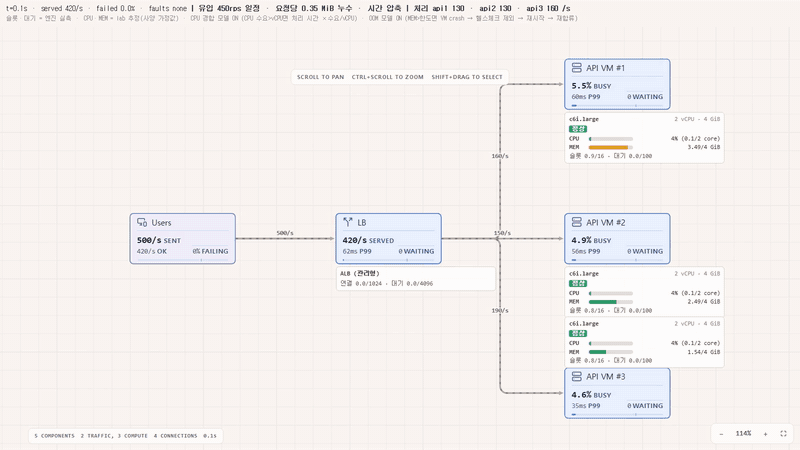
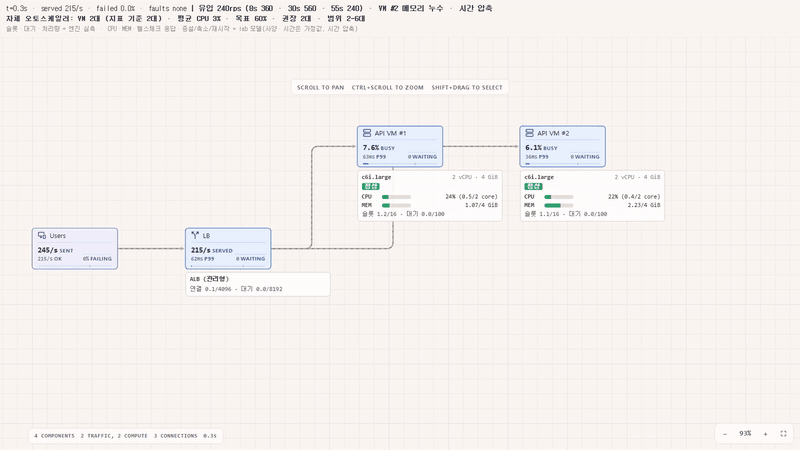
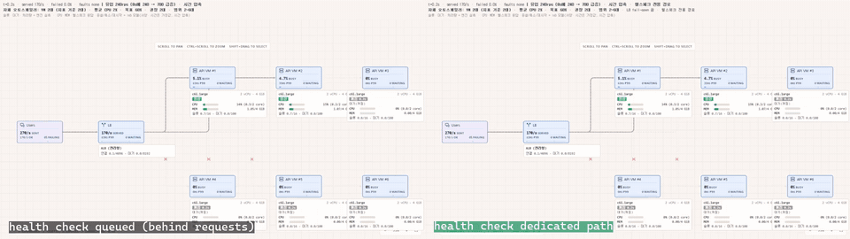

# breakscale_wrap

오픈소스 시스템 설계 시뮬레이터 [Breakscale](https://github.com/xevrion/breakscale)(MIT)을 **한 줄도 고치지 않고** 감싸서,
원본이 일부러 다루지 않는 **VM 단위 장애**(CPU 포화, 부분 OOM)와 **VM 단위 오토스케일링**을 덧붙인 실험 도구입니다.
학습용 시뮬레이터를 "부하 테스트 실측값을 넣어 실제 트래픽 상황을 예측하는 도구"로 쓰는 것이 목표입니다.



## 왜 만들었나 — 원본 Breakscale로 부족했던 점

Breakscale은 큐 적체, 쓰기 락, 서킷브레이커, 오토스케일러 워밍업 지연 같은 **구조에서 생기는 현상**을 잘 보여 줍니다.
하지만 원본은 "측정된 값만 보여 준다"는 원칙(`AGENTS.md`)에 따라, 앱마다 달라지는 값과 기계별 상태를 일부러 두지 않습니다.
그 결과 실전에서 흔한 장애 몇 가지를 표현할 수 없습니다.

| 실전에서 흔한 상황 | 원본 Breakscale | breakscale_wrap |
|---|---|---|
| CPU가 모자라 요청이 느려짐 | CPU 개념 없음. 슬롯만 있으면 동시 처리 수가 늘어도 느려지지 않음 | 처리 중 요청 × 요청당 CPU가 vCPU를 넘으면 처리 시간이 수요/vCPU배로 늘어남 |
| 여러 대 중 **1대만** OOM으로 죽음 | `instances: 3`이어도 슬롯을 하나로 합쳐 계산. 기계별 상태·메모리 없음 | VM 1대 = 노드 1개로 나누고 VM마다 메모리(누수 포함)를 계산. 한도를 넘은 VM만 죽고, 처리 중 요청은 실패 |
| 헬스체크가 잡기 전까지 LB가 죽은 서버로 계속 보냄 | 헬스체크 개념 없음 | 간격·제한 시간·실패/통과 횟수를 가진 헬스체크. 잡기 전 구간은 그대로 실패 |
| 과부하로 헬스체크 응답이 늦어 서버가 연달아 빠지는 연쇄 장애 | 표현 불가 | 헬스체크 응답 시간을 추정하고, 헬스체크 경로(일반 요청과 같은 대기열 / 전용 경로)를 고를 수 있음 |
| 프로세스 재시작, 컨테이너 재시작(백오프), VM 교체 | 표현 불가 | 복구 방식 3가지를 선택. 재시작 후 캐시가 비어 느린 워밍업 구간 포함 |
| VM 단위 오토스케일링 | 원본 오토스케일러는 노드 하나의 대수만 바꿈. VM을 나눈 구성과 함께 쓸 수 없음 | 자체 오토스케일러: 평균 CPU 목표 추적(HPA식), 증설 쿨다운, 축소 관찰 구간, 드레이닝, ALB식 fail-open |

원본 엔진의 계산 결과(슬롯·대기열·처리량·지연·LB 분배)는 그대로 쓰고,
위 모델은 원본에 이미 있는 장애 주입 기능(`crash`·`slow`·`partition`)을 바깥에서 조작하는 방식으로 붙였습니다.
컨트롤러를 끄면 결과가 **공식 MCP 응답과 글자 단위로 같습니다**(23/23).

## 영상

| 장면 | 내용 |
|---|---|
|  | **오토스케일링 전 과정** — 트래픽이 단계적으로 오르면 2→3→5대로 증설, VM #2가 OOM으로 죽었다가 재시작해 돌아오고, 트래픽이 줄면 관찰 시간 뒤 드레이닝하며 2대로 축소 ([mp4](docs/media/asg.mp4)) |
|  | **급증 때 헬스체크 구현이 가르는 결과** — 왼쪽은 헬스체크가 일반 요청 뒤에 줄을 서서 과부하 VM이 연달아 LB에서 빠지는 연쇄 장애, 오른쪽은 전용 경로라 넘치는 요청만 거절 ([mp4](docs/media/asg_spike_health.mp4)) |

화면 상단에는 어떤 값이 **엔진 실측**이고 어떤 값이 **lab 모델 추정**인지 항상 표시됩니다.

## 사용 방법

### 준비물
- Git, [Bun](https://bun.sh) 1.2 이상, Node.js 20 이상
- (영상 녹화 시) [ffmpeg](https://ffmpeg.org)
- (자연어로 쓸 때) [Claude Code](https://claude.com/claude-code)

### 1. 설치 (한 번)
원본 Breakscale은 이 저장소에 포함하지 않습니다. 설치 스크립트가 검증한 커밋으로 받아서 빌드합니다(자세한 내용은 [`vendor/VERSION.md`](vendor/VERSION.md)).

```bash
git clone https://github.com/reddol18/breakscale_wrap.git
cd breakscale_wrap
node lab/setup.mjs        # 원본 받기·고정·빌드, 의존성, 녹화용 Chromium
bun lab/regress.ts        # "23/23 same"이 나오면 정상
```

### 2. Claude Code로 자연어 시뮬레이션
저장소 폴더에서 `claude`를 실행합니다. 처음 실행할 때 `.mcp.json`의 로컬 Breakscale MCP 사용을 승인하면 됩니다.
작업 방법은 [`CLAUDE.md`](CLAUDE.md)에 적혀 있어서, 다음처럼 말하면 Claude Code가 시나리오 파일을 만들고 돌려서 결과를 설명합니다.

> 쇼핑몰 주문 API를 ALB 뒤 c6i.large 2대로 운영 중이야. 평소 초당 250건인데 이벤트 때 순간 3배가 와.
> CPU 60%에서 증설하고 최대 6대, 부팅은 3분 걸려. 헬스체크는 일반 요청과 같은 스레드에서 처리해.
> 이벤트 때 어떻게 되는지 시뮬레이션해서 영상까지 만들어 줘.

실측값(요청당 CPU, 처리 시간, 메모리)이 없으면 Claude Code가 기본값을 넣고 **가정이라고 밝힙니다.**
부하 테스트나 모니터링 수치를 함께 주면 그 값으로 바꿔 돌립니다.

### 3. 직접 쓰기: 시나리오 파일
시나리오는 JSON 파일 하나입니다. `lab/scenarios/<이름>.json`에 두면 이름으로 돌릴 수 있습니다.
형식은 [`lab/core/scenario-file.ts`](lab/core/scenario-file.ts), 예제는 [`example_spike.json`](lab/scenarios/example_spike.json)(오토스케일링)과 [`example_crash.json`](lab/scenarios/example_crash.json)(장애 주입)입니다.

```jsonc
{
  "name": "example_spike",
  "seconds": 70,
  "design":  { "nodes": [...], "edges": [...] },   // 공식 MCP create_view와 같은 형식. VM 1대 = 노드 1개
  "specs":   { "vm1": { "vcpu": 2, "memMiB": 4096, "cpuPerReq": 0.5,
                        "memBaseMiB": 1000, "memPerInflightMiB": 24, "leakPerReqMiB": 0 } },
  "fleet":   { "lb": "lb", "vms": ["vm1", "...", "vm6"], "initial": 2, "bootMs": 5000, "failOpen": true,
               "health":   { "intervalMs": 1000, "timeoutMs": 500, "unhealthyThreshold": 3, "healthyThreshold": 2, "path": "queued" },
               "recovery": { "mode": "process", "restartMs": 3000, ... },
               "scaling":  { "metric": "cpu", "target": 0.6, "min": 2, "max": 6, "scaleInStabilizationMs": 10000, ... } },
  "timeline": [ { "at": 8,  "set": { "users": { "rps": 700 } } },
                { "at": 40, "set": { "users": { "rps": 240 } } } ]
}
```

```bash
bun lab/sim.ts example_spike --every 5     # 시각별 처리·실패·VM 상태, 사건 기록, 요약(VM 대수 변화·VM-초)
node lab/viz/serve.mjs                     # 화면: http://127.0.0.1:4180/?scn=example_spike
node lab/viz/record.mjs samples/lab/out 70 30 spike "scn=example_spike"   # 영상(서버 실행 중, ffmpeg 필요)
node lab/viz/shot.mjs   samples/lab/out 10,30 "scn=example_spike"          # 스크린샷
```

화면 주소 옵션: `?scn=<시나리오>` · `?cpu=0`(CPU 경합 모델 끔, fleet 없는 시나리오에서 원본 동작과 비교)

### 4. 검증
```bash
bun lab/regress.ts        # 컨트롤러 없이 공식 MCP 응답 23건과 글자 단위 비교
bun lab/verify_cpu.ts     # CPU 경합: 처리량 상한이 이론값 V/(p·s)와 맞는지
bun lab/verify_oom.ts     # 부분 OOM: OOM 시각, 헬스체크·재시작·재합류 시각
bun lab/verify_fleet.ts   # 오토스케일러: 대수 계산, 드레이닝, 복구 방식, fail-open, 헬스체크 경로
```

## 구조

```
lab/setup.mjs             설치 스크립트 (원본 고정 커밋 받기·빌드·의존성)
lab/sim.ts                시나리오 실행(텍스트 결과)
lab/scenarios/*.json      시나리오 파일
lab/core/run.ts           실험 실행기 (공식 create_view와 같은 경로 + 컨트롤러 훅)
lab/core/scenario-file.ts 시나리오 파일 형식과 해석
lab/core/meter.ts         공용 계산식: CPU 느려짐 배율, VM 메모리
lab/core/cpu.ts           CPU 경합 컨트롤러 (같은 호스트 공유 포함)
lab/core/oom.ts           부분 OOM 컨트롤러
lab/core/fleet.ts         자체 오토스케일러 + VM 수명(헬스체크·재시작·교체·드레이닝·fail-open)
lab/viz/                  원본 캔버스를 그대로 쓰는 화면 + 노드별 사양 패널, 프레임 단위 녹화기
lab/viz/scenarios.ts      코드로 적은 시나리오(영상에 쓴 것들)
lab/fixtures/official/    회귀 기준: 고정 커밋의 공식 MCP 응답 23건
lab/verify_*.ts           검증 스크립트
samples/lab/              녹화한 영상·스크린샷 전체
```

## 한계

- **값은 가정입니다.** 예제의 요청당 CPU·메모리·누수와 부팅·헬스체크 시간은 설명을 위해 정한 값이고, 영상은 시간을 압축했습니다. 예측에 쓰려면 실측값으로 바꿔야 합니다.
- **헬스체크 응답 시간은 추정입니다.** 엔진이 재는 값이 아니라 `처리 시간 × 느려짐 배율 × (1 + 대기/슬롯)`(전용 경로면 `헬스체크 처리 시간 × 배율`)으로 계산합니다.
- **LB 분배 방식은 원본의 두 가지뿐입니다**(가장 한가한 대상, 가중치 비율). 라운드로빈·해시는 원본을 고치지 않고는 표현할 수 없습니다.
- **CPU 경합은 일반 서비스 노드에만 적용됩니다.** 원본의 `slow` 장애가 DB처럼 자체 슬롯을 쓰는 종류에는 적용되지 않기 때문입니다.
- **lab 모델 결과는 공유 링크·공식 MCP 응답에 남지 않습니다.** 그쪽에는 원본이 아는 정적 설계만 담깁니다.
- **비용은 아직 계산하지 않습니다.** `lab/sim.ts`가 과금 대상 VM-초를 내므로, 시간당 가격을 곱하면 컴퓨팅 비용을 어림할 수 있습니다.
- 화면에는 VM을 최대 6대 정도까지 그리는 것을 전제로 배치했습니다.

## 라이선스와 출처

- 이 저장소의 코드: MIT License ([`LICENSE`](LICENSE))
- Breakscale © xevrion, MIT License — https://github.com/xevrion/breakscale . 이 저장소는 원본 코드를 포함하지 않고, 설치 스크립트로 받은 원본을 import해서 씁니다.
